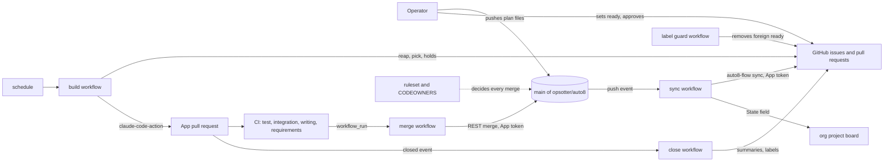
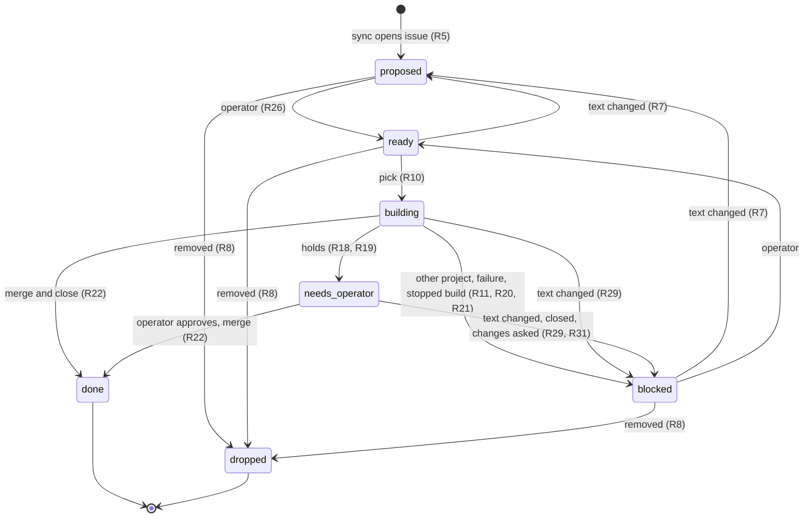
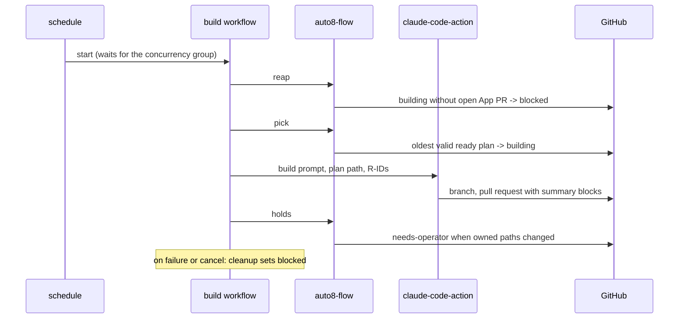
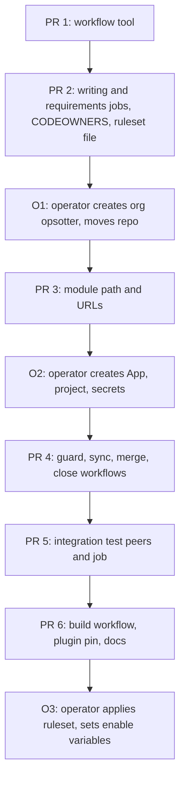

# Requirements workflow for auto8 - Plan

## Goal Capsule

- Objective: the operator drives auto8 from written requirements. A GitHub board shows the state of every requirement at any time. The build agent builds ready requirements, and GitHub merges them without the operator.
- Means: GitHub Actions workflows with their own GitHub App identity, a deterministic workflow tool in Go, and GitHub rulesets in the organization `opsotter` (KTD1, KTD2, KTD4).
- Product authority: the Product Contract of this plan, then the Planning Contract, then `docs/SDLC.md`. The operator rules in `CLAUDE.md` also apply.
- Scope: this plan covers only the workflow. The features of auto8 itself (decoding, assist, call) are not active scope.
- Execution profile: six pull requests, built in an interactive session and merged by the operator by hand. The automatic process does not exist before this plan is done. Three operator steps sit between the pull requests (Operational / Rollout Notes).
- Stop conditions: stop and ask the operator in three cases. A test of V1 to V8 fails. GitHub refuses a ruleset that R17 to R19 need. A step needs a permission that KTD3 does not list.
- Finish: the operator applies the ruleset, sets the enable variables, and watches the first scheduled build. Deploy of auto8 itself is not part of this plan.
- Open blockers: none. The operator steps O1 to O3 must happen in their order.

---

## Product Contract

Product Contract preservation: changed R5, R7, R10, R17, R19, R20, R25, AE8, AE10 and added R29 to R32, after research during planning. The operator confirmed each change on 2026-11-20. R5: the sync step runs by itself. R7 and R29: a text change also stops work in progress. R10 and R32: no second build on a plan with an open pull request. R17 and R30: a fourth required job protects the requirement text. R19: more process files, and the agents cannot change workflow files. R20 and R25: the repository is now `opsotter/auto8`. R31: a held pull request that the operator closes. AE8 and AE10 follow these changes.

On 2026-11-21, the operator changed R6. The issue body now carries a copy of the requirement text. On the same day, every requirement got a short bold name.

Also on 2026-11-21, the operator changed R10 and R19 and added R33 to R35. Without a fixed architecture, a build on ready requirements invents its own stack and order. R33: one architecture document for all plans. R34: a requirement is built only after the operator approved the Planning Contract of its plan. R10 and R35: a build follows the order of the Implementation Units.

### Summary

Each requirement of auto8 lives in a plan file and has one GitHub issue that shows its state on a project board. The operator marks a requirement ready, and a scheduled agent builds it to a pull request. If all required jobs pass, GitHub merges the pull request without the operator. GitHub holds each change to TX control (code that can make the station transmit) or to the process files until the operator approves it. Work in another project waits for the operator.

### Problem Frame

auto8 is a new project, and the operator wants to give its requirements in a formal way. Up to now, work in opsotter started as a chat request. Nothing linked an idea, its refined requirement, and the code that implemented it. To learn what was done and what was open, the operator had to read plan files and git history. Every build also needed the operator in the session.

auto8 can make the station transmit, through WSJT-X or MSHV. A gate is a condition that must be true before a pull request merges. A process that builds and merges without the operator needs gates that GitHub enforces. A statement of the agent is not enough. On the free plan, GitHub enforces required jobs only on public repositories, so auto8 has its own public repository.

### Actors

- A1. The operator: the owner. Writes and refines requirements, marks them ready, reviews held pull requests, makes changes in other projects, and deploys.
- A2. The build agent: a Claude agent in GitHub Actions that a schedule starts. Builds ready requirements and writes the summaries.
- A3. The sync step: keeps one issue for each requirement in the plan files.
- A4. GitHub: runs the CI jobs, enforces the required jobs and the code-owner review, and runs the merge step.
- A5. Other GitHub users: can read the public repository and open issues and comments.

### Key Decisions

- Plan files are the source of the requirement text, and issues only mirror the state. The skills of the Compound Engineering (CE) plugin read files, so `ce-ideate`, `ce-brainstorm` and `ce-plan` work unchanged. Governs R1, R5, R6. (session-settled: user-approved, chosen over issues as the requirement and over one issue per plan, because the CE skills stay unchanged and the state stays per requirement.)
- GitHub Issues with a project board show the state to the operator. Governs R3, R9. (session-settled: user-directed, chosen over a status file in the repository, a reply on request, and a generated web page.)
- Builds run to the merge without the operator. Governs R10, R17. (session-settled: user-directed, chosen over a build that stops at a pull request and over a build that the operator starts.)
- auto8 has its own public repository, so that automatic merges never touch opsotter and GitHub can enforce the required jobs on the free plan. Governs R17. (session-settled: user-directed, chosen over a directory in the private opsotter repository.)
- The integration tests are simulated and run in GitHub CI. Tests with the real programs stay manual, before a deploy. Governs R15. (session-settled: user-directed, chosen over a self-hosted runner with real WSJT-X. A self-hosted runner on a public repository can run code from pull requests of other users.)
- The writing rules are a required job. Governs R16, R17. (session-settled: user-directed, chosen over a linter step of the build agent only.)
- GitHub enforces the holds with a required review by the operator as code owner, and the agents work under their own GitHub identity. Governs R18, R19, R25, R26. (session-settled: user-directed, chosen over a hold by the label of the build agent alone. With the token of the operator, GitHub cannot tell the agent from the operator.)
- A need in another project is only reported. Governs R20. (session-settled: user-directed, chosen over a prepared branch in the other project and over a build of auto8 against a fake.)
- A change to the text of a ready requirement puts its issue back to `proposed`. Governs R7. (session-settled: user-directed, chosen over an issue that stays `ready`, because no build runs on text that the operator did not mark ready.)
- The sync approach is A: sync from the plan files, one issue for each requirement, state as labels. Governs R3 to R9. (session-settled: user-directed, chosen over parent issues with sub-issues and over a done state that only a passing test can set.)
- The operator asked for a dedicated description of the process and for the simple-english rules on all text. Governs R2, R23, R24.
- Ideas get no issue. Only a requirement in a plan file gets one, so the board shows only real requirements. Governs R5.
- One build covers the next pull request of one plan, in the order of its Implementation Units. The units carry the order and the base that the later units need. Governs R10, R35. (session-settled: user-directed on 2026-11-21, chosen over one build for all ready requirements of a plan, because a requirement can span several units.)
- One architecture document governs all plans, and the operator approves the Planning Contract of a plan before its requirements are built. Governs R33, R34. (session-settled: user-directed on 2026-11-21, chosen over decisions that live only inside each feature plan.)

### Requirements

Requirements and state

- R1. **Text lives in the plan.** The text of a requirement lives only in a plan file in `docs/plans`, under a stable ID such as `R3`.
- R2. **One document for the process.** `docs/SDLC.md` describes the whole process: roles, stages, states, gates, holds and the writing rule. It also says which parts of the process work today.
- R3. **One state per requirement.** Every requirement is in exactly one state: `proposed`, `ready`, `building`, `blocked`, `needs-operator`, done, or dropped. `docs/SDLC.md` defines each state and who sets it.
- R4. **One state label at a time.** Whoever sets a state label removes the old state label. If an issue carries more than one state label, the build agent does not build it, and the sync step reports it.

Sync

- R5. **One issue per requirement.** The sync step keeps exactly one issue for each requirement of each plan file. It runs by itself after each push to `main` that changes a plan file. A new requirement gets a new issue in the state `proposed`. The sync step manages only the issues that it opened. It ignores every other issue, also one with the same title.
- R6. **Issue body copies the requirement.** The issue body carries a copy of the requirement text as its description. It links to the requirement in the plan file and names the plan file as the only source of the text. The sync step keeps the copy up to date. If an issue body differs from what the sync step wrote, the sync step does not overwrite it and reports the issue to the operator.
- R7. **Text change resets the state.** If the text of a `ready` or `blocked` requirement changes, the sync step sets its issue back to `proposed` and names the reason.
- R8. **Close a removed requirement.** If a requirement leaves its plan file, the sync step closes its issue as not planned.
- R9. **Project board by state.** A GitHub project board groups all requirement issues by state. Each card names the plan topic and the requirement ID.

Build

- R10. **One build per plan.** A build is one run of the build agent on one plan. A schedule starts the build agent a few times a day, and at most one build runs at a time. Each build takes the plan of the oldest `ready` issue and builds the next pull request of that plan (R35).
- R11. **Clean up a stopped build.** If a build stops without a result, the next run of the build agent sets the label `blocked` on its issues and names that reason.
- R12. **Read requirements only from the plan.** The build agent reads the requirement text from the plan file on `main`. It never takes instructions from issue bodies, comments, or labels that someone other than the operator set.
- R13. **No requirement change in a build.** A pull request of the build agent does not change the text of any requirement.
- R14. **Review and lint each pull request.** Before it opens a pull request, the build agent runs `ce-code-review` and the simple-english linter. It fixes what they find.
- R29. **Changed text blocks the merge.** A requirement text can change while its build runs or its pull request waits. In that case, the pull request does not merge, and the issue goes to `blocked` with that reason.
- R32. **One open pull request per plan.** While a plan has an open pull request of the build agent, no build takes that plan again.

Gates

- R15. **Integration job with three peers.** An integration job in GitHub CI runs auto8 against three peers. The first is a simulated WSJT-X that replays recorded UDP datagrams. The second is a real MQTT broker in a container. The third is a simulated chase-queue that publishes its `/state`. The recorded datagrams hold only made-up callsigns and grids, and no host addresses.
- R16. **Writing job in CI.** A writing job in GitHub CI lints each Markdown file that a pull request changes with `tools/simple-english/ste_lint.py`. One hit makes the job fail.
- R30. **Requirements job in CI.** A requirements job in GitHub CI fails for a pull request of the build agent that changes the text of a requirement.
- R17. **Automatic merge after required jobs.** Automatic merge means that GitHub merges a pull request by itself after all required jobs pass. The required jobs on `main` are the job `test`, the integration job, the writing job and the requirements job. Automatic merge stays off until the integration job and the writing job exist.

Holds

- R18. **Operator approves TX control changes.** A pull request that touches TX control merges only after the operator approves it. GitHub enforces this with a required review by the operator as the code owner of the TX control code. TX control is any code that can make WSJT-X or MSHV transmit. It is also the code that decides the time at which auto8 can ask for a transmission, such as the arm and presence logic. TX control code lives only in the marked paths that the operator owns. If the build agent judges that a change touches TX control, it also sets the label `needs-operator`.
- R19. **Operator approves process file changes.** A pull request that changes a process file merges only after the operator approves it, in the same way as R18. The build agent sets the label `needs-operator`. The process files are `.github/` (with the code owner file), `.claude/`, `tools/simple-english/`, the workflow tool, the integration test peers, `CLAUDE.md` and `docs/SDLC.md`. `docs/ARCHITECTURE.md` is a process file too. The agent identity cannot change workflow files at all. If a build needs such a change, it sets the label `blocked` and describes the change.
- R20. **No code in another project.** If a requirement needs a change in another project, the build agent writes no code there. It describes the change in the issue and sets the label `blocked`. Another project is every repository other than `opsotter/auto8`, for example `kgbvax/opsotter` (with chase-queue), horstreporter and StationA. A change to a vendored copy of code from another project counts as a change in that project. So does a change to the MQTT topics and payloads that another project reads.
- R21. **Block on an unfixed failure.** A build or a job can fail. If the build agent cannot fix the failure in the same build, it sets the label `blocked` on the issue and names the reason.
- R31. **Operator rejects a held pull request.** If the operator closes a held pull request without a merge, or asks for changes, its issues go to `blocked` with that reason. The build agent does not act on review comments.

Architecture and readiness

- R33. **One architecture for all plans.** `docs/ARCHITECTURE.md` holds the architecture and the tech stack of auto8, and every plan follows it. A plan that needs a different decision names the change in a key technical decision. The operator approves that change with the plan. The build agent never changes `docs/ARCHITECTURE.md`.
- R34. **Ready needs an approved Planning Contract.** The build agent builds a requirement only in a plan with an approved Planning Contract that has Implementation Units. The operator records the approval in the plan frontmatter as `planning_approved: <date>`. The pick step takes no `ready` issue of a plan without this key, and the sync step reports such an issue. If the operator changes the Planning Contract later, the operator sets a new date.
- R35. **Build in the order of the units.** A build builds the next pull request of the Implementation Units of its plan, in their order. Each requirement that this pull request names must be `ready`. It follows the key technical decisions of the plan and `docs/ARCHITECTURE.md`, and it plans only inside the units of this pull request. If a unit does not fit them, the build stops, and the issues go to `blocked` with the reason. A requirement is done at the merge of the last pull request that names it.

Close

- R22. **Summaries on the closed issue.** When a requirement is done, its closed issue carries a comment with a feature summary and an implementation summary. The feature summary says what the operator can now do, in the words of the requirement. The implementation summary says what changed in the code and the tests. It links to the pull request and its commits.

Writing

- R23. **Simple English for all text.** All text that the process or an agent writes, in the repository and on GitHub, follows the simple-english skill. This covers requirements, plans, documents, issue comments, pull request descriptions, commit messages, code comments, and user interface text. Agents reply in the output style `simple-english`.
- R24. **Writing tools without an install.** Every session that opens the repository in Claude Code gets the `simple-english` output style, the skill and the linter without a separate install. This includes the sessions of the build agent.

Access

- R25. **Own GitHub identity for agents.** The build agent and the sync step act on GitHub under their own identity, a GitHub App. That identity has access only to `opsotter/auto8` and its project board, and it is not a code owner.
- R26. **Only the operator sets ready.** Only a label `ready` that the operator set counts. GitHub removes a label `ready` that any other identity sets, and the issue names the reason.
- R27. **No secrets in files or logs.** No token or key goes into a file, a log, an issue or a pull request.
- R28. **Plugins pinned to fixed releases.** The Claude Code configuration in `.claude/settings.json` pins each plugin to a fixed release. The operator changes a pin by hand after a review.

### Key Flows

- F1. A requirement enters
  - **Trigger:** the operator has a direction for auto8.
  - **Actors:** A1, A3
  - **Steps:** the operator runs `ce-ideate` (optional) and `ce-brainstorm`, then pushes the plan file to `main`. The sync step runs by itself, and each requirement gets an issue in `proposed`.
  - **Covered by:** R1, R5, R6, R9
- F2. Refine and mark ready
  - **Trigger:** a requirement is `proposed`.
  - **Actors:** A1, A3
  - **Steps:** the operator changes the plan file and pushes it. The sync step updates the issues. If the operator wants a requirement built, the operator sets `ready` on its issue. A later change to its text puts it back to `proposed`.
  - **Covered by:** R3, R4, R6, R7, R8
- F3. Build and merge
  - **Trigger:** the schedule starts the build agent, and at least one issue is `ready`.
  - **Actors:** A2, A4
  - **Steps:** the build agent takes the plan of the oldest `ready` issue and sets the label `building` on the issues of its ready requirements. It plans, codes, reviews and lints, then opens a pull request. GitHub runs the required jobs, and the merge step merges. The summaries go on the closed issues.
  - **Covered by:** R10, R12, R13, R14, R15, R16, R17, R22, R30, R32
- F4. A build stops for the operator
  - **Trigger:** a change touches TX control or a process file, needs another project, or fails.
  - **Actors:** A2, A1
  - **Steps:** the build agent sets `needs-operator` or `blocked` with a reason. GitHub holds a pull request with TX control code or a process file. The operator approves the pull request, or makes the change in the other project and sets `ready` again.
  - **Covered by:** R11, R18, R19, R20, R21, R26, R29, R31

### Acceptance Examples

- AE1. **Covers R18.** Given: a ready requirement adds the Reply message to WSJT-X. Then: after the build agent opens its pull request, the issue is `needs-operator`. GitHub does not merge before the operator approves.
- AE2. **Covers R20.** Given: a ready requirement needs chase-queue to read the decodes of auto8. Then: after the build agent plans it, the issue is `blocked` with a description of the chase-queue change. No branch or pull request exists in opsotter.
- AE3. **Covers R17, R21.** Given: the integration job of a pull request fails, and the build agent cannot fix it in the same build. Then: nothing merges, and the issue is `blocked` with the name of the failed job.
- AE4. **Covers R6.** Given: someone edited an issue body on GitHub. Then: after the sync step runs, that issue keeps the edited body. The report of the sync step names the issue.
- AE5. **Covers R12.** Given: another GitHub user writes a comment on a ready issue and asks for a different change. Then: the build agent builds what the plan file says and ignores the comment.
- AE6. **Covers R8.** Given: the operator removed a requirement from its plan file. Then: after the sync step runs, the issue of that requirement is closed as not planned.
- AE7. **Covers R22.** Given: a pull request merges after the build session ended. Then: each closed issue gets the two summaries and keeps no label `building`.
- AE8. **Covers R10.** Given: a build runs, and the schedule starts the build agent again. Then: the second run waits until the first ends. It takes no issue of a plan with an open pull request.
- AE9. **Covers R7.** Given: the operator changes the text of a `ready` requirement. Then: after the sync step runs, the issue is `proposed` again, and no build takes it.
- AE10. **Covers R19.** Given: a build needs a change to `.github/workflows/ci.yml`. Then: the issue is `blocked` with a description of the change. No pull request of the agent changes the file.
- AE11. **Covers R4.** Given: an issue carries the labels `ready` and `blocked`. Then: no build takes it, and the report of the sync step names it.
- AE12. **Covers R11.** Given: a build stopped in the middle, and its issues still carry `building`. Then: the next run sets `blocked` on them with the reason that the last build stopped without a result.
- AE13. **Covers R16, R17.** Given: a pull request adds a Markdown sentence with a banned modal verb. Then: the writing job fails, and nothing merges.
- AE14. **Covers R18.** Given: the build agent misjudges a change in the TX control paths and does not set `needs-operator`. Then: all jobs pass, but GitHub does not merge before the operator approves.
- AE15. **Covers R26.** Given: another identity sets `ready` on an issue. Then: GitHub removes the label, and no build takes the issue.
- AE16. **Covers R29.** Given: the operator changes the text of a requirement while its pull request waits for the jobs. Then: the pull request does not merge, and the issue is `blocked` with that reason.
- AE17. **Covers R30.** Given: a build pull request splits R3 into two requirements. Then: the requirements job fails, and nothing merges.
- AE18. **Covers R31.** Given: the operator closes a held pull request without a merge. Then: its issues are `blocked` with that reason.

### Success Criteria

- At any time, the operator can open the board and see the state of each requirement and the reason of each stop. The operator does not need to read git history or plan files for this.
- After automatic merge is on, no change reaches `main` of auto8 without a passing job `test`, integration job, writing job and requirements job.
- GitHub blocks every change to TX control code or to a process file until the operator approves it. No agent can reach a repository other than `opsotter/auto8`.

### Scope Boundaries

- The features of auto8 (decoding, assist, call, RTTY) are not part of this plan. They enter through this workflow.
- The process never deploys. The operator deploys by hand.
- Ideas from `ce-ideate` get no issue.
- Tests with the real WSJT-X, MSHV or radio are not part of the gates. They stay a manual step before a deploy.
- A done state that only a passing test can set (approach C of the brainstorm) is deferred. It can be added later without a change to the other requirements.
- Sub-issues for each plan (approach B of the brainstorm) are deferred.

<!-- ce-section: work-relationships -->
### How This Work Fits Together

This plan covers the workflow only. The breakdown below is the current understanding, not a committed roadmap.

- The first feature plan of auto8 (decoding, assist, call)
  - Depends on this workflow for its build.
  - Still to decide: the draft `docs/plans/2026-11-20-1003-feat-auto8-v1-plan.md` is not in the formal format yet. It is the input of the first `ce-brainstorm` run for auto8 features, which replaces it.
  - Depends on a chase-queue change in opsotter (R20 applies). After the sync step opens its issues, the operator sets `blocked` on them with that reason. The operator sets `ready` after the chase-queue change exists.

### Dependencies / Assumptions

- Only the operator can create the organization `opsotter`, move the repository, create the GitHub App, store the secrets and apply the ruleset. Nobody makes a change to the GitHub configuration before the operator agrees to it.
- The build agent uses the Claude subscription of the operator. While its usage limit is used up, builds wait.
- Only collaborators can set labels on GitHub. The operator is the only collaborator. R12 depends on this.
- GitHub enforces R18 only for files in the marked paths. If the build agent puts TX control code outside them, only its own label catches it.

### Sources / Research

- `docs/SDLC.md`: the process description that R2 requires.
- `docs/plans/2026-11-20-1003-feat-auto8-v1-plan.md`: the draft feature plan.
- The simple-english plugin, version 2.1.1, is the source of the output style, the skill and the linter in the repository (`THIRD_PARTY_NOTICES.md`).
- `ce-plan` stores no progress in the plan. `ce-work` derives progress from git. The board of R9 is therefore new.

---

## Planning Contract

### Key Technical Decisions

- KTD1. Runtime: the build agent, the sync step, the label guard, the merge step and the close step run as GitHub Actions workflows in `opsotter/auto8`. The build agent uses `anthropics/claude-code-action`. A Claude cloud scheduled task acts on GitHub as the account of the operator, so it cannot have its own identity. It also cannot reach the GraphQL API that the board needs, and it does not install the plugins of the repository. (session-settled: user-directed, chosen over a Claude cloud scheduled task, because that task acts as the operator.)
- KTD2. Organization: the repository moves to the free organization `opsotter`, which also owns the project board. A GitHub App cannot write to a project board of a personal account, and an organization board allows a real State column. The Go module path becomes `github.com/opsotter/auto8`. (session-settled: user-directed, chosen over one filtered view per state and over a classic token of the operator. The name `opsotter` was chosen over `dl9et`.)
- KTD3. Identity: one GitHub App, `opsotter-auto8`, owned by the organization and installed only on `opsotter/auto8`. Its repository permissions are Contents, Issues and Pull requests (read and write) and Metadata (read). Its organization permission is Projects (read and write). It has no write permission for `workflows`, `administration`, `checks`, `statuses` or `actions`. Each job gets a new one-hour token from `actions/create-github-app-token`. The App is on no bypass list. Without the `workflows` permission, GitHub refuses any push of the App that changes `.github/workflows/`, which R19 needs.
- KTD4. Workflow tool: a deterministic command-line tool in Go, `cmd/auto8-flow` with the package `internal/flow`, in the auto8 module. Every command has `--dry-run`, which prints the planned GitHub changes as JSON and changes nothing. Tests use recorded GitHub responses with `httptest`. A project skill was rejected, because a language model gives different results from run to run and reads more untrusted text.
- KTD5. Issue identity: each issue that the App opens carries a hidden marker in its body. The marker holds the plan path, the R-ID and a hash of the requirement text. The title is `<topic> R<n>: <name>`. The sync step manages only issues that the App authored and that carry a marker (R5). Two plan files with the same `topic` are refused and reported.
- KTD6. Plan parsing: the tool reads only files with `artifact_contract: ce-unified-plan/v1`. It reads requirement lines only from `### Requirements` under `## Product Contract`. A requirement line starts with `- R<n>. `. After the ID, the line can start with a bold name that ends with a period, for example `**Jump to a high-value spot.**`. The name is not part of the hashed text. The text hash is SHA-256 over the text after the name, with normalized white space, cut to 12 hex digits. A name change renames the issue. A text change works as before. "Governs" and "Covers" lines are not requirements.
- KTD7. One build at a time: the build workflow uses the concurrency group `auto8-build` without cancel, so a second run waits (AE8). The pick step skips every plan that has an open pull request of the App (R32). The reap step at the start of each run sets `blocked` on each `building` issue that has no open pull request of the App (R11). A failed or cancelled build job also runs a cleanup step that sets `blocked` with the reason. The tool can set the issues of an open App pull request to `blocked`. It then also closes that pull request with a comment that names the reason. The plan is then free again after the operator sets `ready` (R32).
- KTD8. Merge step: the workflow `merge.yml` merges an App pull request with the App token through the REST merge endpoint. It starts on `workflow_run` of the CI workflow and on `pull_request_review: submitted`. Three conditions must be true before it merges. Every required job passed, no hold label is set, and the requirement comparison against the current `main` passes again (R29). An approval by `kgbvax` releases the label `needs-operator`. If a required job failed, the step sets the issues of the pull request to `blocked` and names the failed job (R21, AE3). If `kgbvax` asks for changes, the step sets the issues to `blocked` with that reason (R31). The ruleset still decides, so GitHub refuses a held or failing pull request. GitHub auto-merge was rejected, because enabling it with an App token has a known fault since 2026-03. The repository variable `AUTO8_MERGE_ENABLED` turns the merge on (R17). The `blocked` results work also while the variable is off.
- KTD9. Close step: the build agent writes both summaries of each requirement into a marked block of the pull request body. A block names its plan path and R-ID, and the close step finds the issue through its marker (KTD5). A workflow on `pull_request: closed` copies each block to its issue and removes the state labels (R22). A pull request that closes without a merge sets its issues to `blocked` (R31). The workflow also has a manual start with a pull request number, for a merged pull request of any author. So the operator can repair a missed close, also for the pull requests of this plan.
- KTD10. Requirements job: the CI job `requirements` runs `auto8-flow reqcheck`. For a pull request of the App, it parses all plans in `docs/plans` on the base and the head with the parser of U1. It compares the full set of topic, R-ID, name and hash. It fails on any difference and on any parser report, for example a duplicate topic or a lost Requirements section (R30). For other authors it passes, because the operator changes requirements. The merge step runs the same comparison against the current `main` (R29).
- KTD11. Writing job: the CI job `writing` lints each changed Markdown file outside `.claude/` with `tools/simple-english/ste_lint.py --gate`. Without `--gate`, the linter always exits with 0. The files under `.claude/` are the copied skill and output style, which quote bad examples on purpose. The job has no path filter, so it always reports a result.
- KTD12. Holds: `.github/CODEOWNERS` names `@kgbvax` for the process files of R19 and for `internal/tx/`, the marked TX control path. A repository ruleset on `main` requires three things. The first is a code-owner review with zero general approvals. The second is the four required jobs with the expected source GitHub Actions. The third is a pull request for every change. The command `auto8-flow holds` compares the changed files of a pull request with `CODEOWNERS`. It sets `needs-operator` on each issue that the pull request closes (R18, R19).
- KTD13. Operator bypass: the organization admin role is on the bypass list with the mode "always". So the operator can push plan edits straight to `main` and merge their own process changes. GitHub does not let an author approve their own pull request, so without this bypass every process change of the operator waits forever.
- KTD14. Label guard: a workflow on `issues: labeled` acts in two cases. It uses an App token, so that it can also write the project State field. If someone other than `kgbvax` sets `ready`, it removes the label and writes the reason (R26). If `kgbvax` sets a state label, it removes the other state labels (R4). The pick step also reads the issue timeline. It accepts an issue only after it finds that `kgbvax` set its latest `ready` label. A label that `GITHUB_TOKEN` sets starts no workflow, so the guard alone is not enough.
- KTD15. Build prompt: the instructions of the build agent live in `.github/auto8/build-prompt.md`, a process file. They freeze the Product Contract, forbid reading issue bodies and comments, map any pause of `ce-plan` to `blocked`, and define the summary blocks. The agent step gets only a read-only App token. It commits locally and writes its state decisions and the pull request body to files. A later step without Claude pushes the branch, opens the pull request and applies the decisions with the full App token. `auto8-flow` accepts only `blocked` and `needs-operator` decisions for the picked issues. So an agent under prompt injection cannot merge, set `ready` or change other issues. The allowed tools are file edits, `go`, `git`, `python3 tools/simple-english/ste_lint.py` and `auto8-flow`. WebFetch and WebSearch are not allowed. `show_full_output` stays off, because the logs of a public repository are public (R27).
- KTD16. Plugin pin: `.claude/settings.json` pins the compound-engineering marketplace with `ref` to commit `fbd794f329f5b65d0ea00a5e6487336c385ff2be`, the release `compound-engineering-v3.33.2` (R28). The build workflow installs the same pin through the `settings` input of the action. The workflow pins each third-party action to a commit SHA.
- KTD17. Claude login: the build workflow uses the secret `CLAUDE_CODE_OAUTH_TOKEN`, which the operator creates with `claude setup-token`. It runs on the subscription of the operator, not on a paid API key.
- KTD18. Schedule: the build workflow runs every four hours and on manual start. The repository variable `AUTO8_BUILD_ENABLED` turns the schedule on. A manual start always runs. GitHub turns off a schedule of a public repository after 60 days without activity, and `docs/SDLC.md` says so.
- KTD19. Integration test peers: the job `integration` runs Go tests with the build tag `integration` and an `eclipse-mosquitto` service container. The test peers in `test/integration/peers/` are a WSJT-X replayer and a chase-queue fake. The test data in `test/integration/testdata/` holds only made-up callsigns and grids. The test peers are process files. The feature tests in `test/integration/` are not.

### High-Level Technical Design

Components and their links:



State machine of one requirement issue:



A requirement can leave its plan while it is `building` or `needs-operator`. It then goes to `blocked`, not to dropped, because a pull request can still close it. A text change after done opens nothing. The sync step reports it.

One scheduled build run:



Bootstrap order:



### Output Structure

```text
cmd/auto8-flow/main.go
internal/flow/            plan parser, marker, GitHub client, sync, pick, reap, holds, close, reqcheck, merge
internal/flow/testdata/   plan fixtures and recorded GitHub responses
internal/tx/              marked TX control path (empty until a feature adds code)
test/integration/peers/   WSJT-X replayer, chase-queue fake
test/integration/testdata/ made-up UDP datagrams
.github/CODEOWNERS
.github/rulesets/main.json
.github/auto8/build-prompt.md
.github/workflows/ci.yml  test, writing, requirements, integration
.github/workflows/label-guard.yml
.github/workflows/sync.yml
.github/workflows/build.yml
.github/workflows/merge.yml
.github/workflows/close.yml
```

### Assumptions

- A repository ruleset accepts a required code-owner review with zero general approvals. Research found this allowed in the documents but not stated as one combination. V5 makes sure that it works.
- A GitHub App with the organization permission Projects can write the State field of an organization project. V2 and V4 make sure that it works.
- The `actor` field of issue label events names the identity that set the label. V7 makes sure that it works.
- The pinned `claude-code-action` loads the compound-engineering plugin at the pin of KTD16 through its `settings` input. V1 makes sure that it works.

### System-Wide Impact

- Access: after O3, only two identities write to `main`. The merge step writes under the App identity, inside the ruleset. The operator writes through the admin bypass (KTD13). No workflow uses `pull_request_target`, and no workflow gives secrets to a pull request from a fork.
- Other projects: nothing in this plan writes to `kgbvax/opsotter`, horstreporter or StationA (R20). The pointer in the opsotter README is a follow-up.
- Operator time: each held pull request and each `blocked` issue waits for the operator. The board shows both, so the operator finds them without a search.
- Claude usage: each build uses the subscription of the operator. A build every four hours sets the upper limit of that use.

### Deferred to Implementation

- The exact GraphQL calls that set the State field of the organization project.
- The exact shape of the timeline events that name the actor of a label.
- The exact JSON of `.github/rulesets/main.json`, as the rulesets API accepts it.
- The `timeout-minutes` value of the build job, from the duration of the first real builds.
- The exact input names of `claude-code-action` for the configuration, the prompt and the allowed tools, at the pinned version.

### Alternatives Considered

- A Claude cloud scheduled task for the build agent: rejected in KTD1.
- One filtered view per state on a personal board: rejected in KTD2.
- GitHub auto-merge: rejected in KTD8.
- A separate test repository with its own App for V1 to V8: not built. The real repository with throwaway pull requests gives the same evidence, because the ruleset and the App under test are the real ones.

---

## Implementation Units

| U-ID | Title | Main files | Depends on |
|---|---|---|---|
| U1 | Plan parser and issue marker | `internal/flow/plan.go`, `internal/flow/marker.go` | none |
| U2 | GitHub client and state labels | `internal/flow/github.go`, `internal/flow/state.go` | U1 |
| U3 | sync command | `internal/flow/sync.go`, `cmd/auto8-flow/main.go` | U1, U2 |
| U4 | pick, reap and mark commands | `internal/flow/build.go` | U2 |
| U5 | holds and reqcheck commands | `internal/flow/holds.go`, `internal/flow/reqcheck.go` | U1, U2 |
| U6 | close and merge commands | `internal/flow/close.go`, `internal/flow/merge.go` | U2, U5 |
| U7 | Writing and requirements jobs | `.github/workflows/ci.yml` | U5 |
| U8 | Code owners and ruleset file | `.github/CODEOWNERS`, `.github/rulesets/main.json` | none |
| U9 | Module path and URLs for opsotter | `go.mod`, docs | O1 |
| U10 | Label guard workflow | `.github/workflows/label-guard.yml` | U2, O2 |
| U11 | Sync workflow and board field | `.github/workflows/sync.yml` | U3, O2 |
| U12 | Merge and close workflows | `.github/workflows/merge.yml`, `.github/workflows/close.yml` | U6, O2 |
| U13 | Integration test peers and job | `test/integration/`, `.github/workflows/ci.yml` | U7 |
| U14 | Build workflow and prompt | `.github/workflows/build.yml`, `.github/auto8/build-prompt.md` | U4, U5, U12 |
| U15 | Plugin pin and process documents | `.claude/settings.json`, `docs/SDLC.md`, `CLAUDE.md` | U14 |

### PR 1: Workflow tool

Waits on: nothing.

### U1. Plan parser and issue marker

- **Goal:** read the requirements of every unified plan in `docs/plans` and build or read the hidden marker of an issue.
- **Requirements:** R1, R5, R6, KTD5, KTD6.
- **Dependencies:** none.
- **Files:** `internal/flow/plan.go`, `internal/flow/marker.go`, `internal/flow/plan_test.go`, `internal/flow/marker_test.go`, `internal/flow/testdata/plans/`.
- **Approach:**
  1. Parse the front matter for `artifact_contract` and `topic`. Skip every file without the unified contract.
  2. Find `### Requirements` under `## Product Contract` and read only its `- R<n>. ` lines, also inside groups.
  3. Hash each text per KTD6.
  4. Report duplicate R-IDs in one plan and duplicate topics across plans.
  5. The marker holds plan path, R-ID and hash in an HTML comment. A body without a valid marker is not an App issue.
- **Patterns to follow:** the standard Go test layout of `cmd/auto8`. Table tests with fixture files.
- **Test scenarios:**
  - This plan file as a fixture gives R1 to R35 with stable hashes, and no "Governs" or "Covers" line becomes a requirement.
  - The draft v1 plan (no unified contract) gives no requirements.
  - A requirement with extra spaces and line breaks gives the same hash as the clean form.
  - Two plans with the same topic give a report line and no requirements for either plan.
  - A plan with R3 twice gives a report line.
  - A marker round trip keeps path, R-ID and hash. A body with a broken marker reads as "no marker".
- **Verification:** the parser tests pass, and the fixture of this plan gives exactly its R-IDs.

### U2. GitHub client and state labels

- **Goal:** one small client for the GitHub calls of the tool and one rule set for the state labels.
- **Requirements:** R3, R4, R25, R27.
- **Dependencies:** U1.
- **Files:** `internal/flow/github.go`, `internal/flow/state.go`, `internal/flow/github_test.go`, `internal/flow/state_test.go`, `internal/flow/testdata/github/`.
- **Approach:**
  1. The client reads the token only from the environment and never prints it.
  2. REST for issues, labels, timeline, pull requests, files and merge. GraphQL only for the project State field.
  3. In dry-run mode, every write becomes one JSON line on standard output.
  4. `state.go` holds the five state labels and one function that sets one state, removes the others (R4) and writes the project State field (R9). Every command that changes a state uses this function.
- **Patterns to follow:** recorded responses served by `httptest`.
- **Test scenarios:**
  - A write in dry-run mode sends no request and prints one JSON line.
  - An error response from GitHub gives an error that does not hold the token.
  - Setting `blocked` on an issue with `ready` removes `ready` and adds `blocked`.
  - An issue with `ready` and `blocked` reads as "two state labels".
  - Setting a state also writes the project State field of the issue.
- **Verification:** the client tests pass, and a search of the test output for the fake token finds nothing.

### U3. sync command

- **Goal:** make the issues match the plan files on `main`.
- **Requirements:** R4 to R9, R29, AE4, AE6, AE9, AE11, KTD5.
- **Dependencies:** U1, U2.
- **Files:** `internal/flow/sync.go`, `internal/flow/sync_test.go`, `cmd/auto8-flow/main.go`.
- **Approach:**
  1. List all issues that the App authored and that carry a marker.
  2. For each requirement without an issue, open one in `proposed`.
  3. For a changed hash: `ready` or `blocked` goes to `proposed` (R7). `building` or `needs-operator` goes to `blocked` with the reason (R29). Update the marker. A done issue only gets a report line.
  4. For a requirement that left its plan: `proposed`, `ready` and `blocked` close as not planned (R8). `building` and `needs-operator` go to `blocked`.
  5. Do not overwrite a body that differs from the expected body (R6). Report it.
  6. Report every issue with two state labels (R4).
  7. Set the project State field of each issue that has none (R9).
  8. Write each report about one issue once as a comment on that issue. A report without an issue, such as a duplicate topic, makes `auto8-flow sync` exit with an error. GitHub then tells the operator about the failed run.
- **Test scenarios:**
  - Covers AE6. A removed requirement in `ready` closes as not planned.
  - Covers AE9. A changed `ready` requirement goes to `proposed` with a reason.
  - Covers AE16. A changed `building` requirement goes to `blocked`.
  - Covers AE4. An edited body stays and gets a report line.
  - Covers AE11. An issue with two state labels gets a report line and no change.
  - An issue of another user with the title `requirements-workflow R3` is not touched.
  - A second run on the same input prints no write.
  - An edited body gives one comment on that issue, and a second run adds no second comment.
  - Two plans with the same topic make the command exit with an error.
- **Verification:** the sync tests pass, and `auto8-flow sync --dry-run` on this repository prints one create line for each requirement.

### U4. pick, reap and mark commands

- **Goal:** choose the next build and clean up after stopped builds.
- **Requirements:** R4, R7, R10, R11, R12, R26, R32, AE8, AE12, AE15, KTD7, KTD14.
- **Dependencies:** U2.
- **Files:** `internal/flow/build.go`, `internal/flow/build_test.go`.
- **Approach:**
  1. `reap` sets `blocked` on each `building` issue that has no open pull request of the App.
  2. `pick` takes the oldest valid `ready` issue. A valid issue has one state label and a latest `ready` event by `kgbvax` in the timeline. Its marker hash matches `main`, and its plan has no open App pull request.
  3. `pick` returns the plan path and all valid ready R-IDs of that plan, and sets `building` on them. Without a valid issue, it returns nothing.
  4. `mark <state> --reason` is the only way for the agent to change a state label.
- **Test scenarios:**
  - Covers AE15. A `ready` set by another identity in the timeline is not valid.
  - Covers AE12. A `building` issue without an open App pull request becomes `blocked` with the reason.
  - A `building` issue with an open App pull request stays `building`.
  - Two plans with ready issues: the plan of the oldest `ready` event wins, with all its ready R-IDs.
  - A plan with an open App pull request is skipped (R32).
  - A marker hash that differs from `main` makes the issue not valid.
  - Setting `blocked` on the issues of an open App pull request also closes that pull request. After the operator sets `ready`, `pick` takes the plan again.
- **Verification:** the build tests pass with recorded timeline responses.

### U5. holds and reqcheck commands

- **Goal:** find held pull requests and changed requirement text.
- **Requirements:** R13, R18, R19, R29, R30, AE14, AE17, KTD10, KTD12.
- **Dependencies:** U1, U2.
- **Files:** `internal/flow/holds.go`, `internal/flow/reqcheck.go`, `internal/flow/holds_test.go`, `internal/flow/reqcheck_test.go`.
- **Approach:**
  1. `holds <pr>` reads `.github/CODEOWNERS` from the base branch and the changed files of the pull request. An owned file sets `needs-operator` on each issue that the pull request closes, through the state function of U2.
  2. `reqcheck --base <ref> --head <ref>` parses all plans on both refs and compares the full set of topic, R-ID and hash. A parser report on the head also fails it. On a request of the merge step, it also compares with the current `main`.
  3. `reqcheck` passes for pull requests whose author is not the App.
- **Test scenarios:**
  - Covers AE17. A head that splits R3 into R3 and R33 fails.
  - A head that only adds a Planning Contract passes.
  - Covers AE16. A head whose R3 matches the base but not the current `main` fails.
  - A pull request that changes `internal/tx/x.go` gets `needs-operator`. One that changes only `cmd/auto8/main.go` does not.
  - A pull request of the operator that changes requirements passes `reqcheck`.
  - An App pull request that adds a second plan with the same topic fails.
  - An App pull request that removes `artifact_contract` from a plan fails.
- **Verification:** the tests pass, and `reqcheck` on the commits of this plan passes for the operator.

### U6. close and merge commands

- **Goal:** finish an App pull request after its jobs or its close.
- **Requirements:** R17, R22, R29, R31, AE7, AE18, KTD8, KTD9.
- **Dependencies:** U2, U5.
- **Files:** `internal/flow/close.go`, `internal/flow/merge.go`, `internal/flow/close_test.go`, `internal/flow/merge_test.go`.
- **Approach:**
  1. `merge <pr>` merges only an App pull request whose required jobs passed. Its issues carry no `needs-operator` or `blocked` label, and `reqcheck` against the current `main` passes. An approval by `kgbvax` counts as a release of `needs-operator`. In every other case, it does nothing and names the reason.
  2. If a required job failed, `merge <pr>` sets the issues to `blocked` and names the failed job. If `kgbvax` asked for changes, it sets them to `blocked` with that reason.
  3. `close <pr>` on a merged pull request finds the issue of each summary block by plan path and R-ID. It copies the block to the issue, removes the state labels, and closes the issue as completed.
  4. `close <pr>` on a pull request closed without a merge sets its issues to `blocked` with that reason (R31).
  5. A summary block that is missing gives a short comment that names the gap and links the pull request.
- **Test scenarios:**
  - Covers AE7. A merged pull request with two summary blocks gives two comments and no `building` label.
  - Covers AE18. A closed pull request without a merge sets `blocked`.
  - A pull request with a failed required job is not merged.
  - Covers AE16. A pull request whose requirement changed on `main` is not merged, and its issue is `blocked`.
  - A pull request of another author is never merged.
  - Covers AE3. A failed integration job sets the issues to `blocked` with the job name.
  - Covers AE1. An approval by `kgbvax` on a held pull request with green jobs merges it.
  - Covers AE18. A review with changes asked sets the issues to `blocked`.
  - A merged pull request of the operator with summary blocks closes the matching issues.
- **Verification:** the tests pass with recorded responses.

### PR 2: Gates and code owners

Waits on: PR 1, merge order only.

### U7. Writing and requirements jobs

- **Goal:** add the required jobs `writing` and `requirements` to CI.
- **Requirements:** R16, R17, R30, AE13, KTD10, KTD11.
- **Dependencies:** U5.
- **Files:** `.github/workflows/ci.yml`.
- **Approach:**
  1. `writing` lints each changed Markdown file outside `.claude/` with `--gate` and fails on one hit.
  2. `requirements` runs `go run ./cmd/auto8-flow reqcheck` with the base and head of the pull request.
  3. Both jobs run on every pull request and on push to `main`, with no path filter.
- **Test scenarios:**
  - Covers AE13. A throwaway pull request with a banned modal verb in a Markdown file fails `writing`.
  - A throwaway pull request with no Markdown change passes `writing`.
- **Verification:** both jobs appear on a pull request with their exact names.

### U8. Code owners and ruleset file

- **Goal:** name the owned paths and keep the ruleset as a reviewable file.
- **Requirements:** R17, R18, R19, KTD12, KTD13.
- **Dependencies:** none.
- **Files:** `.github/CODEOWNERS`, `.github/rulesets/main.json`, `internal/tx/README.md`.
- **Approach:**
  1. `CODEOWNERS` names `@kgbvax` for `.github/`, `.claude/`, `tools/simple-english/`, `cmd/auto8-flow/`, `internal/flow/`, `test/integration/peers/`, `internal/tx/`, `CLAUDE.md` and `docs/SDLC.md`.
  2. `main.json` holds the ruleset of KTD12 and KTD13 in the format of the GitHub rulesets API. The operator applies it in O3.
  3. `internal/tx/README.md` says that all TX control code goes there.
- **Test expectation:** none. This unit holds configuration. V5 tests it after O3.
- **Verification:** GitHub shows no syntax error for `CODEOWNERS` on the pull request.

### PR 3: Move to opsotter

Waits on: PR 2, merge order only. Operator step O1 must be done before this PR starts.

### U9. Module path and URLs for opsotter

- **Goal:** make the code and the documents name `opsotter/auto8`.
- **Requirements:** R20, R25, KTD2.
- **Dependencies:** O1.
- **Files:** `go.mod`, `README.md`, `CLAUDE.md`, `docs/SDLC.md`, `docs/plans/2026-11-20-1039-feat-requirements-workflow-plan.md`.
- **Approach:** change the module path to `github.com/opsotter/auto8` and replace every `kgbvax/auto8` in the documents. Keep `kgbvax/opsotter`.
- **Test expectation:** none. The job `test` proves that the module still builds.
- **Verification:** a search for `kgbvax/auto8` outside `docs/plans` finds nothing. In this plan, it stays only in U9, O1 and Deferred to Follow-Up Work.

### PR 4: Event workflows

Waits on: PR 3, merge order only. Operator step O2 must be done before this PR starts, because its workflows need the App secrets.

### U10. Label guard workflow

- **Goal:** keep `ready` for the operator and keep one state label for each issue.
- **Requirements:** R4, R26, AE15, KTD14.
- **Dependencies:** U2, O2.
- **Files:** `.github/workflows/label-guard.yml`.
- **Approach:** on `issues: labeled`, get an App token and run `auto8-flow mark`, which also writes the project State field (U2). Do nothing for the state labels that the App sets, except `ready`.
- **Test scenarios:**
  - Covers AE15. The App sets `ready` on a throwaway issue. The guard removes it and writes the reason.
  - The operator sets `ready` on an issue with `blocked`. The guard removes `blocked`.
- **Verification:** both scenarios pass on throwaway issues in O3.

### U11. Sync workflow and board field

- **Goal:** run the sync step after each push that changes a plan file.
- **Requirements:** R5, R9, R25, KTD3.
- **Dependencies:** U3, O2.
- **Files:** `.github/workflows/sync.yml`.
- **Approach:** on push to `main` with changes in `docs/plans/`, and on manual start with a `dry_run` input. Get an App token, then run `auto8-flow sync`. The project number comes from the variable `AUTO8_PROJECT_NUMBER`.
- **Test scenarios:**
  - A push of this plan opens one issue for each requirement, each in `proposed`, each on the board.
  - A manual start with `dry_run` changes nothing and prints the plan of changes.
- **Verification:** the board shows the issues of this plan in the State `proposed`.

### U12. Merge and close workflows

- **Goal:** merge green App pull requests and finish their issues.
- **Requirements:** R17, R22, R29, R31, KTD8, KTD9.
- **Dependencies:** U6, O2.
- **Files:** `.github/workflows/merge.yml`, `.github/workflows/close.yml`.
- **Approach:**
  1. `merge.yml` runs on `workflow_run` of the CI workflow and on `pull_request_review: submitted`, for App pull requests. It merges only while `AUTO8_MERGE_ENABLED` is `true`.
  2. `close.yml` runs on `pull_request: closed` for App pull requests. It also has a manual start with the number of a merged pull request of any author.
  3. Neither workflow runs on events from forks or uses `pull_request_target`.
- **Test scenarios:**
  - With the variable off, a green App pull request stays open.
  - With the variable on, a green App pull request merges, and its issues get the summaries.
  - An approval by `kgbvax` on a held pull request with green jobs starts the merge.
- **Verification:** V4 passes after O3.

### PR 5: Integration job

Waits on: PR 4, merge order only.

### U13. Integration test peers and job

- **Goal:** run auto8 against the three simulated peers in CI.
- **Requirements:** R15, R17, KTD19.
- **Dependencies:** U7.
- **Files:** `test/integration/peers/wsjtx.go`, `test/integration/peers/chasequeue.go`, `test/integration/testdata/`, `test/integration/smoke_test.go`, `.github/workflows/ci.yml`.
- **Approach:**
  1. The WSJT-X replayer sends recorded datagrams to a UDP address. The chase-queue fake publishes a retained `/state` on the broker.
  2. The job `integration` starts `eclipse-mosquitto` as a service container and runs `go test -tags integration ./test/integration/...`.
  3. The smoke test builds `cmd/auto8`, starts it against the peers, and makes sure that it exits without an error. Later feature plans add assertions.
- **Execution note:** start with the smoke test against the broker, because the test peers have no other consumer yet.
- **Test scenarios:**
  - The replayer sends each datagram of the test data, and a test listener receives them in order.
  - The chase-queue fake publishes `/state`, and a new subscriber receives it as retained.
  - The test data holds no callsign of the operator and no host address.
- **Verification:** the job `integration` passes on a pull request.

### PR 6: Build agent

Waits on: PR 5, merge order only.

### U14. Build workflow and prompt

- **Goal:** run one scheduled build per period under the App identity.
- **Requirements:** R10 to R14, R18 to R21, R27, R32 to R35, AE1 to AE3, AE5, AE8, AE10, KTD1, KTD7, KTD15, KTD17, KTD18.
- **Dependencies:** U4, U5, U12.
- **Files:** `.github/workflows/build.yml`, `.github/auto8/build-prompt.md`.
- **Approach:**
  1. Triggers: a schedule every four hours and manual start. The schedule acts only while `AUTO8_BUILD_ENABLED` is `true`. A manual start always runs.
  2. Steps: full App token, `reap`, `pick`, then `claude-code-action` with a read-only App token, the prompt file, the plan path and the R-IDs. After it, a step without Claude pushes the branch, opens the pull request, applies the state decisions through `auto8-flow`, and runs `holds` (KTD15).
  3. A cleanup step with `if: failure() || cancelled()` sets `blocked` with the reason.
  4. The prompt tells the agent to decide `blocked` with a description in three cases: a need in another project, a change to a workflow file, or a missing `ce-plan`, `ce-work` or `ce-code-review` (R14, R19, R20).
  5. Concurrency group `auto8-build`, no cancel, `timeout-minutes` for the job.
- **Test scenarios:**
  - Covers AE8. A second manual start waits until the first run ends.
  - A manual start with no valid `ready` issue ends without a pull request.
  - Covers AE5. A comment with orders on a ready issue does not change the diff, and the tool log shows no read of comments.
  - A state decision for an issue that the run did not pick is refused.
- **Verification:** V1, V4 and V6 pass after O3.

### U15. Plugin pin and process documents

- **Goal:** pin the plugin and describe the finished process.
- **Requirements:** R2, R23, R24, R28, KTD16, KTD18.
- **Dependencies:** U14.
- **Files:** `.claude/settings.json`, `docs/SDLC.md`, `CLAUDE.md`, `README.md`.
- **Approach:**
  1. Add the `ref` pin of KTD16 to the marketplace entry.
  2. Update `docs/SDLC.md`: the automatic sync, the merge step, the new states of R29 and R31, the operator bypass, the 60-day schedule rule and "What works today".
  3. Update `CLAUDE.md` with the workflow tool and the enable variables.
- **Test expectation:** none. The writing job tests the documents.
- **Verification:** a local Claude Code session in the repository loads the compound-engineering plugin at the pinned release.

---

## Verification Contract

- Unit tests: `go build ./...`, `go vet ./...` and `go test -race ./...` from the repository root, on every pull request.
- Integration: `go test -tags integration ./test/integration/...` with a broker on `localhost:1883`, in the job `integration`.
- Writing: `python3 tools/simple-english/ste_lint.py --type descriptive --gate <file>` for each changed Markdown file.
- Dry runs: `go run ./cmd/auto8-flow sync --dry-run` against the live repository with a read token.
- Live tests after O3, on `opsotter/auto8` with throwaway issues and pull requests:
  - V1. The App is the author of the pull request, commits, labels and comments of a build run, and the operator can approve it. The run log shows that `ce-plan`, `ce-work` and `ce-code-review` ran at the pinned release.
  - V2. The sync step opens, keeps, resets and closes issues as the U3 scenarios say, and the board State follows. After the operator sets `ready`, the card moves without a plan push.
  - V3. `pick` takes the right plan with two plans ready.
  - V4. A cancelled build gives `blocked`. A late merge gives both summaries. A pull request closed without a merge gives `blocked`.
  - V5. A green App pull request that changes an owned file does not merge before the operator approves it, and it merges after the approval. A green one that changes no owned file merges.
  - V6. A comment with orders does not change the build.
  - V7. The guard removes a `ready` that the App sets.
  - V8. The public logs and texts of V1 to V7 hold no token.

---

## Definition of Done

- Every unit is merged in the order of its PR group, and every item of the Verification Contract passes.
- The operator applied the ruleset, and GitHub shows the four required jobs and the code-owner rule on `main`.
- `AUTO8_BUILD_ENABLED` and `AUTO8_MERGE_ENABLED` are `true`, and one scheduled build ran without the operator.
- The issues of this plan show their real state on the board. For each pull request of this plan, the operator started the close workflow by hand. So the issues of the built requirements are closed with their summaries.
- `docs/SDLC.md` "What works today" names no missing part.
- No code from abandoned attempts is left in the diff.

---

## Operational / Rollout Notes

- O1. The operator creates the free organization `opsotter` and moves `kgbvax/auto8` into it. GitHub keeps a redirect from the old URL.
- O2. The operator creates the App `opsotter-auto8` with the permissions of KTD3 and installs it only on `opsotter/auto8`. The operator stores `AUTO8_APP_ID`, `AUTO8_APP_PRIVATE_KEY` and `CLAUDE_CODE_OAUTH_TOKEN` as Actions secrets. The operator creates the organization project "auto8 requirements" with a single-select field State and stores its number as the variable `AUTO8_PROJECT_NUMBER`.
- O3. After PR 6, the operator applies `.github/rulesets/main.json` with `gh api` and sets `AUTO8_MERGE_ENABLED` to `true`. The operator runs V1 to V8 with manual starts of the build workflow. If all pass, the operator sets `AUTO8_BUILD_ENABLED` to `true`. If a test fails, the operator sets `AUTO8_MERGE_ENABLED` back to `false`.
- The pull requests of this plan carry summary blocks. After U12 exists, a manual start of the close workflow writes the summaries of R22 for them.

---

## Risks

| Risk | Mitigation |
|---|---|
| A ruleset refuses zero approvals with a code-owner review. | V5 shows it. The fallback is one required approval, which makes every agent pull request wait for the operator. The operator decides. |
| The App cannot write the State field of the organization project. | V2 shows it. The sync step then leaves the field empty, and the operator uses saved views with a label filter. |
| Prompt injection through text in the public repository. | The agent reads no issue text (KTD15), the requirement text comes only from `main`, and the ruleset is the last defense. |
| GitHub turns off the schedule after 60 days without activity. | `docs/SDLC.md` names the rule, and the operator starts the workflow again by hand. |
| The usage limit of the subscription stops a build. | The cleanup step and `reap` set `blocked`, and the reason names the stop. |
| A third-party action changes. | Each action is pinned to a commit SHA (KTD16). |

---

## Deferred / Open Questions

The entries below are review items left for the author. They do not block implementation.

### From 2026-11-20 review

- **Dependency changes merge without the operator**: R19, the process files (P2, security-lens, confidence 75)

  A build pull request can add or change a third-party Go module, and it merges by itself, because `go.mod` and `go.sum` are not process files. That module code then runs in the next build job, which holds the Claude token and the App token. It also runs in auto8 itself, outside the hold on TX control.

  Change: add `go.mod` and `go.sum` to the process files of R19 and to the code owner list of U8.

- **The success criterion ignores the operator bypass**: Success Criteria and KTD13 (P2, coherence, confidence 100)

  The criterion says that no change reaches `main` without the four jobs, but the operator pushes plan edits past them through the admin bypass. A tester who follows the criterion marks it failed, or removes the bypass that KTD13 needs.

  Change: say that no change of the build agent reaches `main` without the four jobs. Only the operator can push past them, through the admin bypass.

- **R8 closes every removed requirement, but the sync step blocks two states**: R8 and U3 (P2, coherence, confidence 100)

  R8 says that the sync step closes the issue of any removed requirement as not planned. U3 sends an issue in `building` or `needs-operator` to `blocked` instead, because a pull request can still close it. A tester who follows R8 closes an issue that an open pull request still targets.

  Change: add to R8 that an issue in `building` or `needs-operator` goes to `blocked` instead, with that reason.

- **R17 defines automatic merge as a GitHub feature that KTD8 rejects**: R17 and KTD8 (P3, coherence, confidence 75)

  R17 says that GitHub merges by itself, but KTD8 uses its own merge step and rejects the GitHub auto-merge feature. A reader of R17 can turn on the repository auto-merge option that KTD8 rejected.

  Change: define automatic merge as the merge step that merges a pull request after all required jobs pass.

- **R10 says oldest ready issue, U4 says oldest ready event**: R10 and U4 (P3, coherence, confidence 75)

  An issue that was opened early but set to `ready` late gives a different plan under each reading, so V3 has no single expected answer.

  Change: say in R10 that a build takes the plan of the ready issue whose latest `ready` label is the oldest.

- **R16 lints every changed Markdown file, but KTD11 skips `.claude/`**: R16 and KTD11 (P3, coherence, confidence 50)

  A job built from R16 alone fails on every change to the copied skill, which quotes bad examples on purpose.

  Change: say in R16 that the writing job lints each changed Markdown file outside `.claude/`.

---

## Deferred to Follow-Up Work

- R33 to R35 are new on 2026-11-21. The units of this plan do not cover them all yet. The pick step (U4) must read `planning_approved` and the order of the Implementation Units. The close step (U6) must keep an issue open up to the merge of the last pull request that names it. The build prompt (U14) must tell the agent to follow the Planning Contract and not to plan again outside the units of its pull request. The code owner file lists `docs/ARCHITECTURE.md` since 2026-11-21. Run `ce-plan` on this plan to add these changes to the units.

- Update the pointer to auto8 in the opsotter README and `CLAUDE.md` from `kgbvax/auto8` to `opsotter/auto8`. This is a change in another project, so the operator or a separate session makes it.
